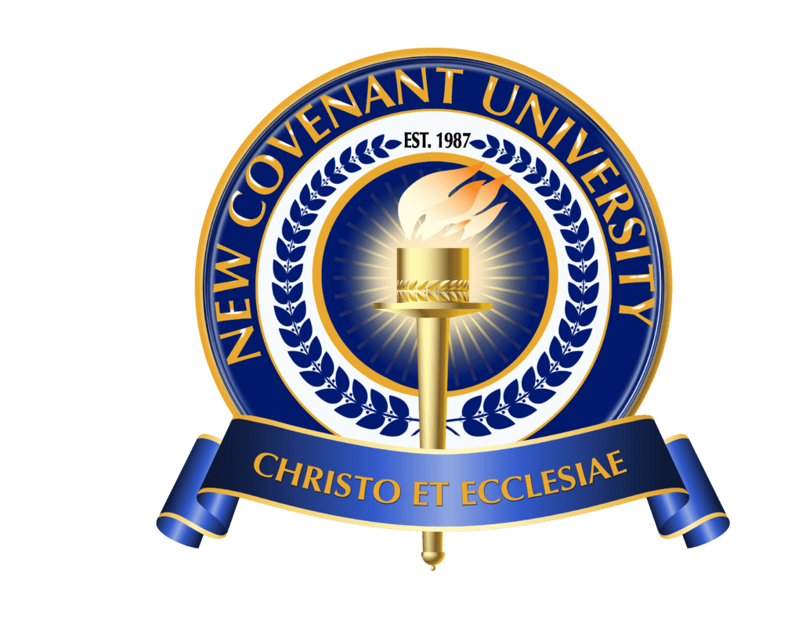
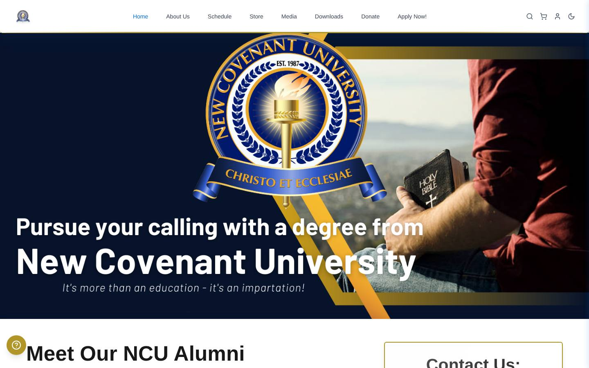
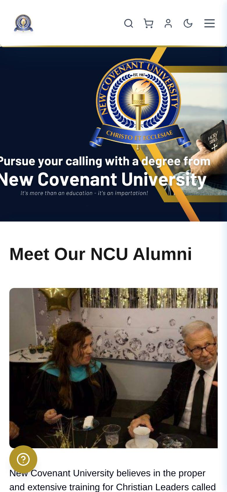

  

<h1 align="center"><a href="https://ncu.education">New Covenant University</a></h1>

The official website of New Covenant University (NCU), which has trained Christian leaders for ministry, entrepreneurship and education since 1987. Prospective students can compare four degree levels, read the actual course syllabi and apply online. Supporters can give or pick up a book from the university store, all from one site that works on any screen.

<strong>Live site:</strong> <a href="https://ncu.education">ncu.education</a>

  <a href="#what-it-is">About</a> · <a href="#features">Features</a> · <a href="#book-or-get-in-touch">Contact</a> · <a href="#connected-brands">Connected brands</a> · <a href="#license">License</a>

  
  
  
  
  
  

<table>
  <tr>
    <td align="center" valign="top">
       
      Home page on desktop.
    </td>
    <td align="center" valign="top">
       
      The same page on a phone.
    </td>
  </tr>
</table>

## What it is

This is the front door of New Covenant University. It answers the questions a future student actually has: which degrees are offered, what each course covers, when classes meet, what it costs and how to apply. It also gives alumni, donors and the wider community a place to read the school's story, see reviews and support its work.

Zathena Ventures designed, built and hosts the site.

## Features

### Academics
- **Four degree levels**: [Associate of Arts](https://ncu.education/degrees/associate-of-arts), [Bachelor of Arts](https://ncu.education/degrees/bachelor-of-arts), [Master of Arts](https://ncu.education/degrees/master-of-arts) and [Doctorate](https://ncu.education/degrees/doctorate), each with its own page under [Degrees](https://ncu.education/degrees).
- **Course syllabi on the page**: every program lists its courses, and syllabi read as normal web pages with a PDF download as backup.
- **Course search**: search across all syllabi and site pages to find a subject quickly.
- **Schedule**: the class schedule and academic calendar on the [Schedule](https://ncu.education/schedule) page.
- **Downloads**: the Student Handbook, Tuition and Fees, Graduate Studies Notebook and Course Catalogue on the [Downloads](https://ncu.education/downloads) page.

### About the university
- **Story and mission**: founding history, mission and core values on the [About](https://ncu.education/about) page.
- **Meet the President**: a profile of Dr. Angel L. Crites, Ed.D; D.Th, with biography and credentials.
- **Alumni showcase**: a rotating set of alumni stories and testimonials.
- **Reviews**: student and community Google reviews shown on the home page.

### Connect and give
- **Apply online**: the admission application on the [Apply](https://ncu.education/apply) page.
- **Donate**: several ways to give, with a confirmation after each gift, on the [Donate](https://ncu.education/donate) page.
- **Bookstore**: the [Store](https://ncu.education/store) offers books as gifts for a donation of $15 or more, with cart, checkout and a receipt.
- **Contact**: a contact form plus phone, email, mailing address, campus locations and social links.

### Accounts
- **Student and donor profile**: see order history, donation history and account details in one place.
- **Faster checkout**: the shipping address fills in from the most recent order, and guests can check out without an account.

### Comfort and access
- **Responsive layout**: built for phones, tablets and desktops.
- **Dark and light mode**: follows the device setting and remembers a manual choice.
- **Accessibility panel**: adjust font size, contrast and motion from a floating help button.
- **Site search**: instant keyword search across pages and course content.

## Book or get in touch

Questions about admissions, courses or giving go through the [Contact](https://ncu.education/contact) page. Ready to start? [Apply here](https://ncu.education/apply).

## Connected brands

- **Built and hosted by** [Zathena Ventures](https://github.com/ZATHENA-VENTURES/ZathenaVentures-Public), the Fort Worth, Texas studio behind the site ([zathenaventures.xyz](https://zathenaventures.xyz)).

## License

© 2026 New Covenant University. All rights reserved.

## Credits & Contact

- **Website:** [ncu.education](https://ncu.education)
- **Contact:** [ncu.education/contact](https://ncu.education/contact)
- **Designed, built and hosted by:** [Zathena Ventures](https://zathenaventures.xyz)

> This is the public showcase of a private repository. It presents the project, its features and its live site, and leaves out source code and deployment details.
